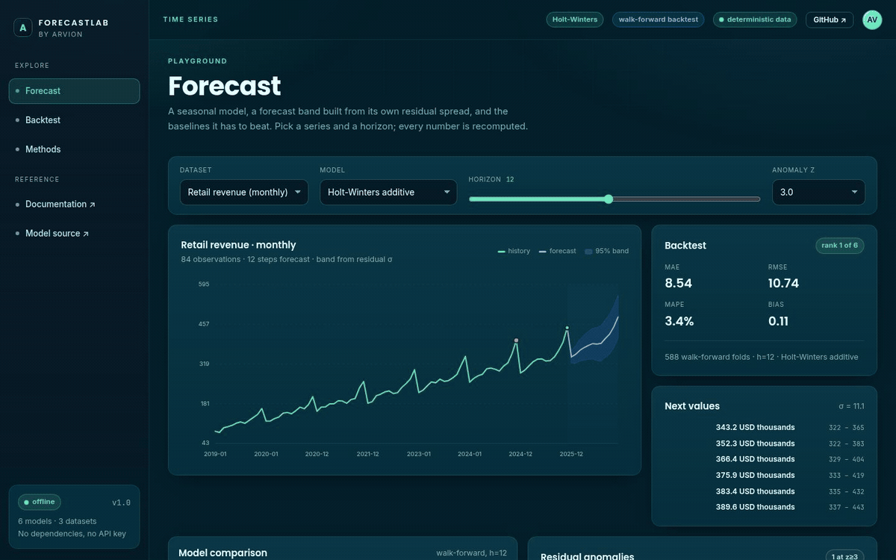
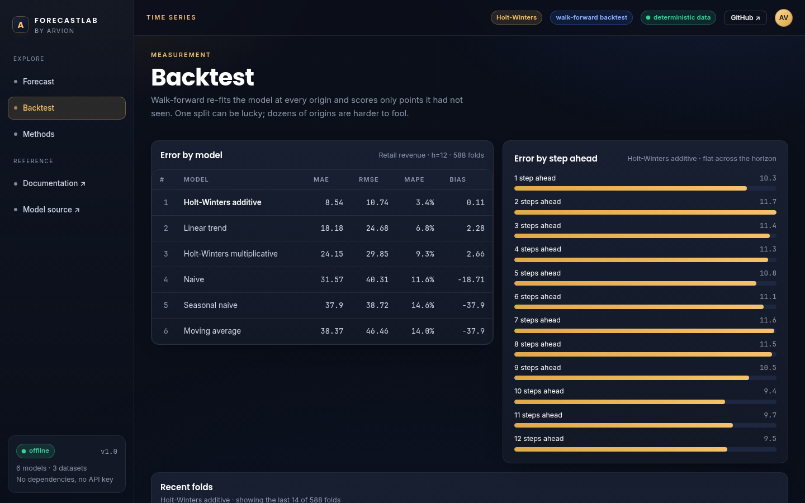

<div align="center">

</div>

<sub>Recorded from the live demo, <a href="docs/demo.mp4">MP4</a> · <a href="docs/screenshot.png">static frame</a></sub>

# ForecastLab

Time-series forecasting and walk-forward backtesting in plain JavaScript. Holt-
Winters with additive or multiplicative seasonality, four baselines to beat, MAE
/ RMSE / MAPE with an explicit bias number, residual anomaly detection, and a
forecast band built from the model's own error rather than a guessed percentage.
The browser playground and the Node library are the same code.

[**Live demo**](https://arvion-technology.github.io/labs/demos/forecastlab/demo/) · [MIT](LICENSE)

---

Most forecasting examples show one model on one series and a chart that looks
convincing. The hard part is not fitting a curve; it is knowing whether the curve
is better than "same as last month", and how that answer changes as you move the
forecast origin. ForecastLab ships the model, the baselines, the backtest and the
chart together so the number on screen is measured on points the model had not
seen when it was fitted.

The demo has three deterministic datasets: daily web traffic with a weekly
cycle, monthly retail revenue with an annual cycle, and two weeks of hourly
energy load. Every point is generated from a fixed seed, so the tests assert
exact forecasts and the screenshots stay reproducible.

## What it does

- **Fit** additive and multiplicative Holt-Winters with fixed, documented
  smoothing parameters.
- **Compare** against seasonal naive, moving average, linear trend and naive.
  the honest question is always "did this beat the baseline?".
- **Backtest** walk-forward, re-fitting at every origin and scoring only unseen
  points, with metrics per horizon step.
- **Measure** MAE, RMSE, MAPE (zero-safe) and bias, plus the fold count so a
  metric with eleven samples is not mistaken for evidence.
- **Detect anomalies** from residual z-scores against a rolling local baseline.
- **Draw** a 95% band that widens as √h from the residual standard deviation.
- **Play** in the browser: dataset, model, horizon and anomaly threshold are
  live controls, and every panel recomputes.

## Screenshots

| Forecast playground | Walk-forward backtest |
| --- | --- |
|  |  |

## Architecture

```
  src/datasets.js      3 seeded series (weekly / annual / daily cycles)
          │
          ▼
  src/series.js        mean, std, diffs, seasonal indices, OLS
          │
          ├──► src/holt-winters.js   additive + multiplicative recursion
          └──► src/baselines.js      naive, seasonal naive, MA, linear trend
                      │
                      ▼
  src/models.js        one fit(values, config) contract for all six models
          │
          ├──► src/backtest.js   walk-forward → folds
          │         │
          │         ▼
          │    src/metrics.js    MAE, RMSE, MAPE, bias, summarise
          │
          ├──► src/anomalies.js  residual z-scores, forecast band
          └──► demo/app.js       controls, SVG chart, metrics tables
```

The demo imports the same functions the tests import. The chart is drawn from
`fit.forecast` and `forecastBand()`, not from a second implementation.

## Quickstart

```bash
git clone https://github.com/arvion-technology/forecastlab.git
cd forecastlab
npm test          # 44 tests, no dependencies, Node 20+
npm run demo      # static server on http://localhost:4173
```

Use it as a library:

```js
import { datasetById, valuesOf } from "./src/datasets.js";
import { fitModel } from "./src/models.js";
import { walkForward } from "./src/backtest.js";

const dataset = datasetById("retail-monthly");
const values = valuesOf(dataset);

const fit = fitModel("hw-additive", values, { horizon: 12, seasonLength: 12 });
console.log(fit.forecast.slice(0, 3));           // next three months

// Walk-forward is where the model has to prove itself.
const result = walkForward(dataset.points, "hw-additive", {
  horizon: 12,
  seasonLength: 12,
  minTrain: 24,
});
console.log(result.metrics.mae, result.metrics.mape, result.folds.length);
```

## How it works

### The model

Holt-Winters keeps three things: a level, a trend, and one seasonal factor per
position in the cycle. After each observation it updates all three:

```
L(t) = α·(y(t) − S(t−m)) + (1−α)·(L(t−1) + T(t−1))
T(t) = β·(L(t) − L(t−1)) + (1−β)·T(t−1)
S(t) = γ·(y(t) − L(t)) + (1−γ)·S(t−m)
```

The forecast extends the level by `h` steps of trend and applies the seasonal
factor for the matching cycle position. Multiplicative seasonality replaces the
additions with ratios; it is rejected on a series containing zero or negative
values, because the ratio is undefined rather than small.

Parameters are fixed at α=0.35, β=0.1, γ=0.3. There is no optimiser. That is a
deliberate limitation: optimising three parameters per series would beat these
defaults, hide the model behind an autotuner, and make the tests fragile. The
optimiser can be added on top of `fitHoltWinters` later.

### The band

Forecast uncertainty grows with the horizon. The band is
`ŷ ± 1.96 · σ · √h`, where σ is the standard deviation of the in-sample
residuals. It is a normal approximation, not a prediction interval with coverage
guarantees, and the methods panel says so.

### The backtest

A single train/test split can be lucky in either direction. Walk-forward re-fits
at every origin from `minTrain` to `n − h`, predicts the next `h` points, and
scores every fold. For the retail dataset at h=12 that is 588 folds. It is slower
than one split, and the fold count is displayed next to every metric so the
sample size is visible.

On that dataset the model comparison is not close, and this is the part worth
checking:

| model | MAE | RMSE | MAPE |
| --- | --- | --- | --- |
| Holt-Winters additive | 8.54 | 10.74 | 3.4% |
| Linear trend | 18.18 | 24.68 | 6.8% |
| Holt-Winters multiplicative | 24.15 | 29.85 | 9.3% |
| Naive | 31.57 | 40.31 | 11.6% |
| Seasonal naive | 37.90 | 38.72 | 14.6% |
| Moving average | 38.37 | 46.46 | 14.0% |

Those numbers come from the same walk-forward run the demo shows. On the hourly
energy dataset the ordering changes: seasonal naive wins slightly, which is a
useful reminder that a more complex model is not automatically the better one.

### Anomalies

Residuals are standardised against the previous `window` residuals, not against
the whole series. A point is flagged when `|z| ≥ threshold` (default 3). The
rolling baseline matters: a series with a noisy quarter would otherwise flag
every point in it as anomalous. When a deterministic series has zero residual
spread, any deviation is flagged rather than skipped, dividing by zero would
silently hide the one event worth seeing.

## Tests

```bash
npm test
```

44 tests on `node:test`:

- `series.test.js`: mean, sample std, differences, seasonal indices, OLS.
- `holt-winters.test.js`: recovers a clean seasonal trend within tolerance,
  first-season nulls, multiplicative positivity and factor scale, horizon
  length, parameter validation.
- `metrics.test.js`: MAE/RMSE/bias by hand, MAPE zero handling.
- `backtest.test.js`: no leakage (training window ends before the target),
  naive predicts the previous value, multi-step fold count, per-model errors
  reported rather than thrown, hand-computed metrics.
- `anomalies.test.js`: spike and drop detection, clean series, null fitted
  values, rolling-history requirement, band width.
- `datasets.test.js`: determinism, season lengths, HW fits every dataset.

```bash
node scripts/serve-check.mjs    # demo bundle checks
```

## Limitations

- **Fixed smoothing parameters.** No grid search or maximum-likelihood
  optimisation; a tuned library will beat these defaults on real data.
- **One seasonal cycle.** No multiple seasonality, holiday regressors or
  exogenous variables.
- **Normal-approximation band.** Not a calibrated prediction interval.
- **Three generated datasets.** They are deterministic and documented, not a
  benchmark; the model ranking here does not transfer to your data.
- **No streaming or persistence.** The library is pure functions over arrays.

## Project layout

```text
forecastlab/
├── src/
│   ├── datasets.js     # 3 seeded series
│   ├── series.js       # small stats and series helpers
│   ├── holt-winters.js # additive and multiplicative recursion
│   ├── baselines.js    # four baselines
│   ├── models.js       # uniform model registry
│   ├── backtest.js     # walk-forward and model comparison
│   ├── metrics.js      # MAE, RMSE, MAPE, bias
│   └── anomalies.js    # residual z-scores and forecast band
├── test/               # 44 node:test cases
├── demo/               # playground, imports ../src directly
├── scripts/            # serve, screenshot, asset checks
└── docs/               # screenshots
```

## Credits

Built by [Arvion Technologies](https://arviontech.net) in Kathmandu as part of our
open-source [Labs](https://github.com/arvion-technology/labs) series. If you need
a forecast you can defend in a meeting, the backtest table is the part to copy.

MIT licensed.
